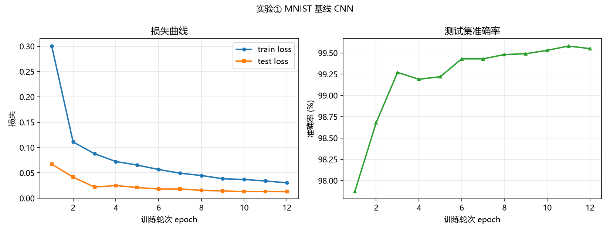
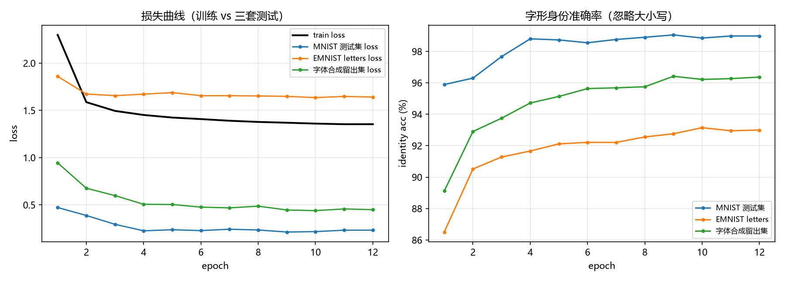
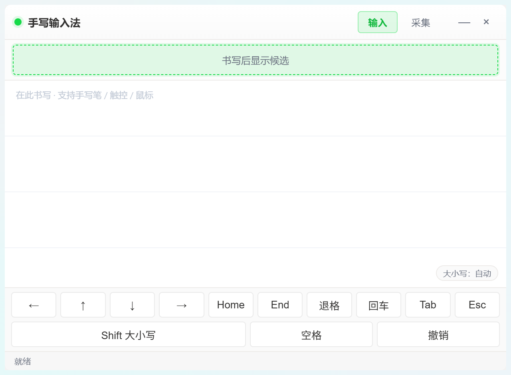
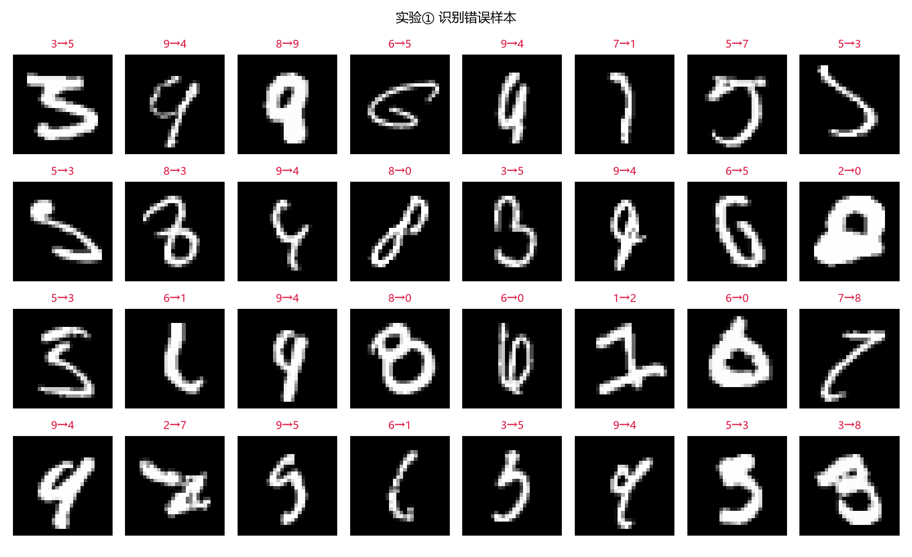

# ✍️ TonhTze Handwriting IME


---

## ℹ️ About the Project

**TonhTze Handwriting IME** is a handwriting input method for Windows. You click into any text box, a handwriting panel pops up, you write with a pen, a finger or a mouse, and the recognised character is inserted at the caret — without stealing focus from the application you are typing in.

It started as the classic MNIST course experiment (train a CNN, plot the loss curves, analyse the errors, test with your own handwriting) and grew into a working input method that recognises **100 character classes**: digits, upper- and lower-case Latin letters, 32 ASCII punctuation marks, and `Æ æ Œ œ Ê ê`.

The panel is rendered by Chromium (HTML/CSS inside WebView2), so it can be restyled without touching any training code; the window itself is a frameless, rounded, Mica-backed Win32 window that never appears in the taskbar.

---

## ✨ Features

| Category | Features |
| :--- | :--- |
| **Recognition** | 100 classes, 28×28 CNN (299.8 K parameters), ~10 ms per character on CPU |
| **Input** | Pen / touch / mouse via Pointer Events; pen pressure drives stroke width |
| **Behaviour** | Starts hidden in the system tray, pops up when an editable field gains focus, hides when focus leaves |
| **Non-intrusive** | `WS_EX_NOACTIVATE` — writing never steals the caret from the target application |
| **Candidates** | Top-6 character candidates (click to replace), word candidates from the conlang dictionary (only `dh` shown) |
| **Insertion** | Clipboard + `Ctrl+V` injection, far more reliable across applications than synthetic keystrokes |
| **Keys** | Arrows, Home/End, Backspace, Enter, Tab, Esc, Space, Shift, undo |
| **Collection mode** | Built-in labelled data collection; the panel doubles as a dataset recorder |
| **Personalisation** | Fine-tuning on your own handwriting lifts accuracy from 70.5 % to 95.5 % on held-out samples |

---

## 📦 Project Layout

```
mnist/
├─ app/                    runtime
│  ├─ server.py            HTTP service + inference + collection
│  ├─ desktop.py           desktop shell: server + focus watcher + hotkeys + injection
│  ├─ win32_helper.py      window styling, SendInput, clipboard, foreground tracking
│  ├─ shell/               C# / WinForms + WebView2 native window
│  └─ static/              panel front-end (HTML/CSS/JS)
├─ src/                    models, data pipeline, training, evaluation
├─ tools/                  build / packaging scripts
├─ assets/                 logo SVGs (text converted to paths)
├─ data/                   word list, collected handwriting, caches
├─ runs/                   training logs, metrics, weights, figures
├─ dist/TonhTzeIME/        packaged application
└─ docs/                   images, extra notes
```

---

## 🚀 Quick Start

```bat
start_ime.cmd
```

That starts the HTTP service and the native shell. The panel stays hidden in the tray; click into any text field and it appears near the bottom-right corner.

| Action | How |
| :--- | :--- |
| Show / hide panel | `Ctrl+Alt+H`, or tray menu |
| Quit completely | Tray icon → 退出, or `Ctrl+Alt+Q`, or close the `ime_shell.exe` process |
| Drag the panel | Drag the title bar of the panel |
| Write a character | Write, then pause 1.2 s — it is inserted automatically |

---

## 🖊️ Using the IME

1. Click into a text box in any application.
2. The panel pops up. Write one character on the pad.
3. Stop writing for 1.2 seconds. The top candidate is inserted at the caret.
4. Wrong character? Click another candidate — the previous character is deleted and replaced.
5. Keep writing letters to build a word; word candidates appear above the pad.
6. Click elsewhere and the panel hides itself.

The panel never takes keyboard focus, so your cursor stays exactly where it was.

---

## 🎯 Character Set

100 classes in total:

| Group | Count | Characters |
| :--- | :--- | :--- |
| Digits | 10 | `0`–`9` |
| Upper case | 26 | `A`–`Z` |
| Lower case | 26 | `a`–`z` |
| Punctuation | 32 | `` ! " # $ % & ' ( ) * + , - . / : ; < = > ? @ [ \ ] ^ _ ` { \| } ~ `` |
| Extra letters | 6 | `Æ æ Œ œ Ê ê` |

---

## 🧱 How It Works

### 🧩 Canonicalisation

Every data source — MNIST, EMNIST, synthetic fonts, your own strokes — goes through one pipeline:

1. crop to the ink bounding box,
2. scale so the **long edge is 20 px** (aspect ratio preserved, never stretched),
3. centre by **centre of mass** inside 28×28,
4. invert to white-on-black and normalise to 0…1.

Preserving the aspect ratio matters: the identity of `-`, `|`, `'`, `.` lives in that ratio. Measured cost of the pipeline on MNIST: **0.00 percentage points**.

### 🧠 Models

| Model | Purpose | Parameters |
| :--- | :--- | :--- |
| `MnistNet` | course baseline, 10 classes | 431 K |
| `GlyphNet` | 100 classes, GAP head | 299.8 K |

### 🔧 Training choices that mattered

* **Identity-group cross-entropy + label smoothing** for case-merged data. Forcing a 50/50 split between `a` and `A` teaches the model to hesitate and lets logits explode; requiring only that probability mass lands inside the group fixes it.
* **BatchNorm recalibration** on clean, mixed-source data after every epoch. Training inputs are always augmented, so running statistics drift away from the clean test distribution.
* **`foreach=False`** for AdamW and `clip_grad_norm_`. On this Intel Arc iGPU the fused multi-tensor kernels are either 6× slower or fail outright.

---

## 🧪 Experiments

### 🔢 ① MNIST Baseline

* 431 K parameters, AdamW, cosine schedule, 12 epochs, batch 256, online affine/thickness/noise augmentation
* **Test accuracy 99.58 %** (42 errors out of 10 000), 5.8 minutes on CPU



The test loss sits *below* the training loss because the training side is measured on augmented samples. Both curves fall together, so there is no overfitting.

### 🔡 ② 100-Class Model

Data per epoch: 150 000 samples sampled by inverse class frequency from MNIST (60 K), EMNIST letters (124.8 K) and 40 K synthetic glyphs covering punctuation and `Æ æ Œ œ Ê ê`.

| Evaluation set | Identity accuracy | Top-5 | Strict accuracy |
| :--- | :--- | :--- | :--- |
| MNIST test | **98.98 %** | 99.92 % | 98.98 % |
| EMNIST letters test | **93.00 %** | 99.44 % | — (case merged) |
| Synthetic hold-out | **96.37 %** | 99.67 % | 89.52 % |

Trained in **6.1 minutes** on the Intel Arc 140V iGPU.



### ✍️ ③ Your Own Handwriting

The panel was used to collect **1002 samples covering all 100 classes**, deliberately varying position, size and writing style (for example both printed and cursive `a`).

Before any personalisation the general model scores **72.5 %** on that data, with digits at 96.0 %, upper case 91.4 %, lower case 70.4 % and punctuation 49.7 %.

Fine-tuning on 802 samples and evaluating on 200 held-out samples:

| Stage | Identity accuracy | Strict accuracy |
| :--- | :--- | :--- |
| General model | 70.50 % | 66.00 % |
| Personalised | **95.50 %** | 92.50 % |
| Gain | **+25.00 pp** | +26.50 pp |

The shipping weights (`runs/exp2_final/best.pt`) are trained on all 1002 samples on top of the 100-class model, keeping the public benchmarks intact: MNIST 98.58 %, EMNIST 92.80 %, synthetic 96.72 %.

---

## 📊 Results



---

## 🔍 Error Analysis

The 42 MNIST errors are dominated by four confusion pairs:

| Pair | Count | Cause |
| :--- | :--- | :--- |
| `9 → 4` | 7 | open-top 9 shares the upper structure of 4 |
| `5 → 3` | 4 | the top bar becomes too short, the lower bowl looks like 3 |
| `3 → 5` | 3 | the reverse: the upper arc is drawn as a straight line |
| `7 → 1` | 2 | the horizontal stroke almost disappears |



Four underlying causes: broken topology (open vs closed loops), stroke merges or missing strokes, abnormal aspect ratio, and the training-domain gap (MNIST was written by census clerks and high-school students).

On the 100-class model, the most frequent confusions are case flips of the same identity (`z→Z`, `x→X`, `w→W`), which do not count as identity errors. Real identity errors concentrate on homoglyphs: `0↔O`, `1↔I↔l`, `0↔o`.

---

## 🔠 Case and Homoglyphs

Isolated glyphs do **not** carry case information after bounding-box normalisation — `c` and `C` become the same image. The project therefore splits the responsibility:

* the **model** identifies the glyph identity,
* the **UI** decides case from the relative height of the character inside the current line (≥1.30× the running median → upper case),
* the **candidate strip** lets you override with one click, and `Shift` forces upper case.

Homoglyph groups such as `{0,O,o}`, `{1,I,l,|}`, `{2,Z,z}`, `{5,S,s}` are disambiguated by looking at the last eight typed characters: a run of digits pushes the digit member, a run of letters pushes the letter member.

---

## 🗣️ Word Candidates

`data/words.json` contains 2818 entries of the constructed language dictionary (`dh` romanisation → meaning). Typing letters shows up to ten completions; clicking one appends the remaining letters. The same list also constrains single-character recognition: with prefix `to`, only letters that keep the prefix valid are boosted.

---

## 🛠️ Building from Source

```bat
python tools/fetch_webview2.py     :: download WebView2 SDK (~10 MB)
python tools/build_shell_cs.py     :: compile the native shell (Roslyn csc from Visual Studio)
python tools/build_dist.py         :: assemble dist\TonhTzeIME\
```

Requirements: Python 3.10+, Visual Studio with the C++ desktop workload (for Roslyn `csc.exe`), and the WebView2 Runtime (shipped with Edge). No .NET SDK is required.

Training (optional):

```bat
python -m src.train_mnist    :: experiment ①
python -m src.analyze_exp1
python -m src.train_ext      :: experiment ②
python -m src.analyze_exp2
python -m src.train_final    :: merge collected handwriting into the shipping model
```

---

## 📄 License

[MIT](LICENSE) — Copyright © 2026 TonhTze AI, Copyright © 2021-2026 Dorn Hub.

Datasets, the WebView2 SDK and other third-party components are covered by their own terms; see [THIRD-PARTY-NOTICES.md](THIRD-PARTY-NOTICES.md).

---

## 🙏 Credits

* MNIST — Yann LeCun, Corinna Cortes, Christopher J.C. Burges
* EMNIST — Gregory Cohen, Saeed Afshar, Jonathan Tapson, André van Schaik (data from NIST SD19)
* WebView2 — Microsoft
* PyTorch, NumPy, Pillow, SciPy, Matplotlib, fontTools — their respective authors
* The Dorn Hub design language provided the colour tokens and visual grammar

---

## ©️ Copyright

Copyright © 2026 TonhTze AI. All rights reserved.
Copyright © 2021-2026 Dorn Hub. All rights reserved.

A toast with Prickly Pear juice!

Dorn Hub

---
---

# ✍️ TonhTze 手写输入法


---

## ℹ️ 关于本项目

**TonhTze 手写输入法** 是一个 Windows 平台的手写输入工具。你点进任意输入框，手写面板自动弹出；用笔、手指或鼠标写一个字，识别结果直接落在光标处——**不会把焦点从你正在打字的程序里抢走**。

它起于经典的 MNIST 课程实验（训练 CNN、画损失曲线、分析错误、用自己的手写数字测试），最终长成一个可用的输入法，识别 **100 类字符**：数字、大小写拉丁字母、32 个 ASCII 半角标点，以及 `Æ æ Œ œ Ê ê`。

面板由 Chromium 渲染（WebView2 里的 HTML/CSS），改样式不用碰任何训练代码；窗口本身是无边框、圆角、Mica 材质的 Win32 窗口，且**不会出现在任务栏**。

---

## ✨ 功能

| 类别 | 说明 |
| :--- | :--- |
| **识别** | 100 类，28×28 CNN（29.98 万参数），CPU 单字约 10 ms |
| **输入** | 笔 / 触控 / 鼠标统一走 Pointer Events，笔压控制笔锋粗细 |
| **行为** | 启动后藏在托盘；焦点进入可编辑控件时弹出，离开时收起 |
| **不打扰** | `WS_EX_NOACTIVATE`，书写全程不夺取目标窗口的光标 |
| **候选** | Top-6 候选字（点一下替换）；人造语词表候选（只显示 `dh`） |
| **插入** | 剪贴板 + `Ctrl+V` 注入，跨程序比模拟按键可靠得多 |
| **按键** | 方向键、Home/End、退格、回车、Tab、Esc、空格、Shift、撤销 |
| **采集模式** | 内置带标注的数据采集，面板同时是数据集录制器 |
| **个性化** | 用你自己的笔迹微调，留出样本上从 70.5% 提升到 95.5% |

---

## 📦 目录结构

```
mnist/
├─ app/                    运行期
│  ├─ server.py            HTTP 服务 + 推理 + 采集
│  ├─ desktop.py           桌面外壳：服务 + 焦点监听 + 热键 + 注入
│  ├─ win32_helper.py      窗口样式、SendInput、剪贴板、前台窗口跟踪
│  ├─ shell/               C# / WinForms + WebView2 原生窗口
│  └─ static/              面板前端（HTML/CSS/JS）
├─ src/                    模型、数据管线、训练与评估
├─ tools/                  构建与打包脚本
├─ assets/                 Logo SVG（文字已转路径）
├─ data/                   词表、采集到的手写样本、缓存
├─ runs/                   训练日志、指标、权重、图表
├─ dist/TonhTzeIME/        打包好的应用
└─ docs/                   图片与补充说明
```

---

## 🚀 快速开始

```bat
start_ime.cmd
```

它会拉起 HTTP 服务与原生外壳。面板先藏在托盘里，点进任意输入框后从屏幕右下角弹出。

| 操作 | 方式 |
| :--- | :--- |
| 显示 / 隐藏面板 | `Ctrl+Alt+H`，或托盘菜单 |
| 完全退出 | 托盘图标 → 退出，或 `Ctrl+Alt+Q`，或结束 `ime_shell.exe` 进程 |
| 移动面板 | 拖动面板标题栏 |
| 写一个字 | 写完停顿 1.2 秒，自动插入 |

---

## 🖊️ 怎么用

1. 在任意程序里点进一个输入框。
2. 面板弹出，在书写区写一个字。
3. 停笔 1.2 秒，首选候选自动插入到光标处。
4. 认错了就点其它候选——上一个字会被删掉并替换。
5. 连续写字母会积累成词，笔上方出现候选词。
6. 点到别处，面板自行收起。

面板全程不获取键盘焦点，所以你的光标停在原处一动不动。

---

## 🎯 字符集

共 100 类：

| 分组 | 数量 | 字符 |
| :--- | :--- | :--- |
| 数字 | 10 | `0`–`9` |
| 大写 | 26 | `A`–`Z` |
| 小写 | 26 | `a`–`z` |
| 标点 | 32 | `` ! " # $ % & ' ( ) * + , - . / : ; < = > ? @ [ \ ] ^ _ ` { \| } ~ `` |
| 特殊字母 | 6 | `Æ æ Œ œ Ê ê` |

---

## 🧱 实现要点

### 🧩 规范化管线

所有数据源——MNIST、EMNIST、字体合成、你的笔迹——都走同一条管线：

1. 裁到墨迹包围盒，
2. 等比缩放，**长边 = 20 px**（保持长宽比，绝不拉伸），
3. 按**质心**居中放进 28×28，
4. 反色为白字黑底、归一化到 0…1。

保持长宽比是关键：`-`、`|`、`'`、`.` 的身份全在长宽比里。实测这条管线对 MNIST 的代价是 **0.00 个百分点**。

### 🧠 模型

| 模型 | 用途 | 参数量 |
| :--- | :--- | :--- |
| `MnistNet` | 课程基线，10 类 | 43.1 万 |
| `GlyphNet` | 100 类，GAP 收尾 | 29.98 万 |

### 🔧 三个真正影响成败的训练选择

* **身份组交叉熵 + 标签平滑**：大小写合并的样本不要求 a/A 各半，只要求概率质量落在正确的身份组里。逼它对半分会让模型"学会犹豫"，还会把 logits 推向爆炸。
* **每轮用干净的混合数据重算 BN 统计量**：训练输入永远被增强过，滑动统计量会偏离干净测试分布，白丢 5~10 个点。
* **AdamW 与 `clip_grad_norm_` 一律 `foreach=False`**：在这块 Intel Arc 核显上，融合多张量内核要么慢 6 倍，要么直接报错。

---

## 🧪 实验

### 🔢 ① MNIST 基线

* 43.1 万参数，AdamW + 余弦退火，12 轮，batch 256，在线仿射/粗细/噪声增强
* **测试集准确率 99.58%**（1 万张错 42 张），CPU 训练 5.8 分钟


测试损失低于训练损失，因为训练侧是在增强样本上统计的；两条曲线同步下降，没有过拟合迹象。

### 🔡 ② 100 类模型

每轮从 MNIST（6 万）、EMNIST letters（12.48 万）与 4 万张字体合成图（覆盖标点与 `Æ æ Œ œ Ê ê`）中按类别反频率采样 15 万张。

| 评估集 | 身份准确率 | Top-5 | 严格准确率 |
| :--- | :--- | :--- | :--- |
| MNIST 测试集 | **98.98%** | 99.92% | 98.98% |
| EMNIST letters 测试集 | **93.00%** | 99.44% | —（大小写合并） |
| 字体合成留出集 | **96.37%** | 99.67% | 89.52% |

在 Intel Arc 140V 核显上训练 **6.1 分钟**。


### ✍️ ③ 自己的手写数据

用面板采集了 **1002 条、覆盖全部 100 类**的样本，采集时刻意变化了位置、大小与写法（例如 `a` 的印刷体与手写体都写）。

在没有任何个性化之前，通用模型在这批数据上只有 **72.5%**：数字 96.0%、大写 91.4%、小写 70.4%、标点 49.7%。

用其中 802 条微调、200 条留出评估：

| 阶段 | 身份准确率 | 严格准确率 |
| :--- | :--- | :--- |
| 通用模型 | 70.50% | 66.00% |
| 个性化后 | **95.50%** | 92.50% |
| 净提升 | **+25.00 个百分点** | +26.50 个百分点 |

发货权重（`runs/exp2_final/best.pt`）是在 100 类模型基础上、用全部 1002 条数据再训 6 轮得到的，公共基准没有退化：MNIST 98.58%、EMNIST 92.80%、合成 96.72%。

---

## 📊 实际效果


---

## 🔍 错误分析

MNIST 的 42 个错误集中在四组混淆：

| 混淆对 | 次数 | 原因 |
| :--- | :--- | :--- |
| `9 → 4` | 7 | 开环的 9 与 4 的上半结构相同 |
| `5 → 3` | 4 | 顶部横笔过短，下半弧线与 3 同形 |
| `3 → 5` | 3 | 反向：3 的上半弧被写成直线 |
| `7 → 1` | 2 | 横笔几乎消失 |


四类根因：拓扑退化（开环/闭环）、笔画粘连或缺失、长宽比异常、训练域偏差（MNIST 由人口普查局职员与高中生书写）。

100 类模型上最常见的"混淆"其实是同一身份的大小写互换（`z→Z`、`x→X`、`w→W`），在身份口径下不算错；真正的身份错误集中在同形字符：`0↔O`、`1↔I↔l`、`0↔o`。

---

## 🔠 大小写与同形字符

孤立字形做完包围盒归一化后**不携带大小写信息**——`c` 与 `C` 是同一张图。因此本项目把职责拆开：

* **模型**负责字形身份；
* **界面**根据该字在当前行里的相对高度判大小写（≥ 本行中位数 1.30 倍 → 大写）；
* **候选条**一键改，`Shift` 强制大写。

`{0,O,o}`、`{1,I,l,|}`、`{2,Z,z}`、`{5,S,s}` 这类同形组，用"最近 8 个已输入字符"裁决：连续数字就抬数字成员，连续字母就抬字母成员。

---

## 🗣️ 候选词

`data/words.json` 收录 2818 条人造语词条（`dh` 罗马字拼写 → 释义）。写字母时给出最多 10 个补全，点一下补齐剩余字母。同一张表还反向约束单字识别：前缀是 `to` 时，只有能让前缀继续保持合法的字母才被加权。

---

## 🛠️ 从源码构建

```bat
python tools/fetch_webview2.py     :: 下载 WebView2 SDK（约 10 MB）
python tools/build_shell_cs.py     :: 编译原生外壳（用 Visual Studio 自带的 Roslyn csc）
python tools/build_dist.py         :: 组装 dist\TonhTzeIME\
```

环境要求：Python 3.10+、装有 C++ 桌面工作负载的 Visual Studio（为了 Roslyn `csc.exe`）、以及 WebView2 运行时（随 Edge 安装）。**不需要 .NET SDK**。

训练（可选）：

```bat
python -m src.train_mnist    :: 实验①
python -m src.analyze_exp1
python -m src.train_ext      :: 实验②
python -m src.analyze_exp2
python -m src.train_final    :: 把采集到的手写数据并进发货模型
```

---

## 📄 许可证

[MIT](LICENSE) —— Copyright © 2026 TonhTze AI，Copyright © 2021-2026 Dorn Hub。

数据集、WebView2 SDK 等第三方组件遵循各自条款，见 [THIRD-PARTY-NOTICES.md](THIRD-PARTY-NOTICES.md)。

---

## 🙏 致谢

* MNIST —— Yann LeCun、Corinna Cortes、Christopher J.C. Burges
* EMNIST —— Gregory Cohen、Saeed Afshar、Jonathan Tapson、André van Schaik（数据源自 NIST SD19）
* WebView2 —— Microsoft
* PyTorch、NumPy、Pillow、SciPy、Matplotlib、fontTools —— 各自的作者
* Dorn Hub 的设计语言提供了配色令牌与视觉语法

---

## ©️ 版权信息

Copyright © 2026 TonhTze AI. All rights reserved.
Copyright © 2021-2026 Dorn Hub. All rights reserved.

敬上一杯刺梨汁

Dorn Hub
